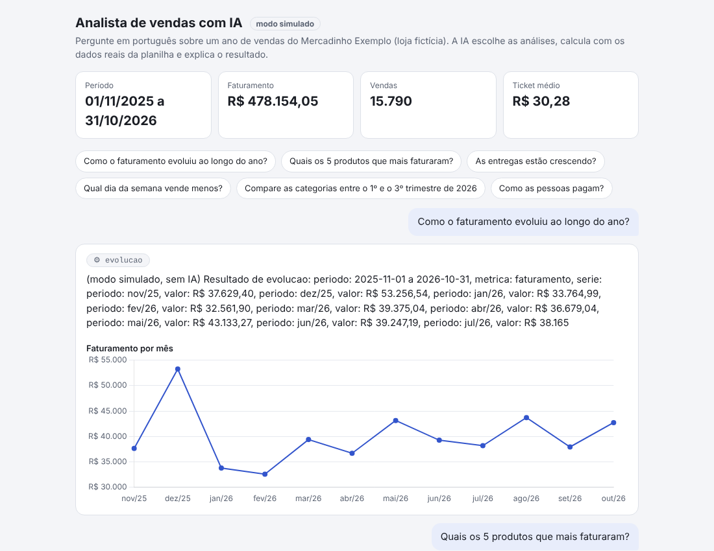

# Analista de vendas com IA · Mercadinho Exemplo

Pergunte em português sobre um ano de vendas de uma loja de bairro fictícia, como "As entregas estão crescendo?" ou "Qual dia da semana vende menos?". O **Gemini** escolhe as análises, o servidor calcula com **pandas** e a resposta volta explicada, com gráfico.

**Demo:** https://analista-vendas-mercadinho.onrender.com — plano gratuito: a primeira visita depois de um tempo parado pode levar uns 50 s para acordar o servidor.



## Por que o modelo não escreve código

A IA não roda código nem inventa números. Ela escolhe entre cinco funções de análise e preenche os parâmetros. Quem calcula é o servidor, e a resposta só pode citar o que as funções devolveram.

| Função | Para perguntas como |
|---|---|
| `resumo` | "Quanto vendemos em outubro?" (faturamento, vendas, ticket médio e variação contra o período anterior) |
| `ranking` | "Quais os 5 produtos que mais faturaram?" |
| `evolucao` | "Como o faturamento evoluiu ao longo do ano?", "As entregas estão crescendo?" |
| `distribuicao` | "Qual dia da semana vende menos?", "Como as pessoas pagam?" |
| `comparar` | "Compare as categorias entre o 1º e o 3º trimestre" |

O modelo pode encadear funções, até 5 rodadas, antes de responder. Cada função usada aparece como etiqueta na resposta; ao clicar, aparecem os argumentos e o resultado bruto.

## Os dados

`app/data/vendas.csv` tem cerca de 35 mil itens vendidos, de nov/2025 a out/2026, gerados por `scripts/gerar_dados.py` com padrões para a análise encontrar:
- pico de faturamento em dezembro;
- bebidas em alta nos meses quentes;
- domingo com meio expediente;
- entregas crescendo a partir de junho;
- promoção de café em agosto.

## Rodar localmente

```bash
pip install -r requirements.txt
export GEMINI_API_KEY=...   # chave gratuita do Google AI Studio; sem ela, roda no modo simulado
uvicorn app.main:app --reload
```

Testes: `pip install pytest httpx && pytest`

## Publicar no Render

Novo Blueprint apontando para este repositório (`render.yaml`). No painel, preencha `GEMINI_API_KEY`. Limites da demonstração: Gemini 3.5 Flash Lite (maior cota gratuita), 20 perguntas por conversa e 80 por dia.

## Stack

Python, FastAPI, pandas, Gemini (SDK `google-genai`), Chart.js, pytest, Render.

---
Loja, produtos e vendas são fictícios.
